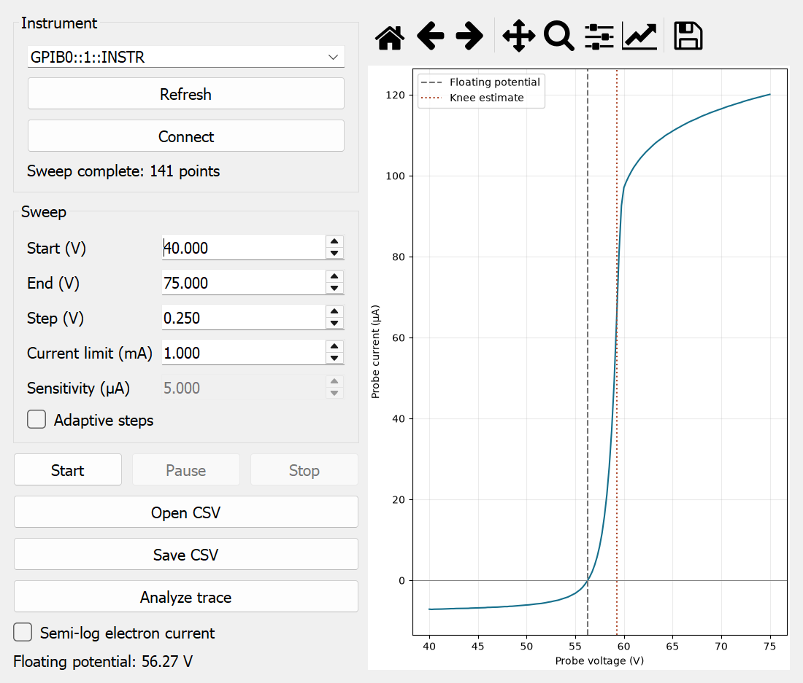
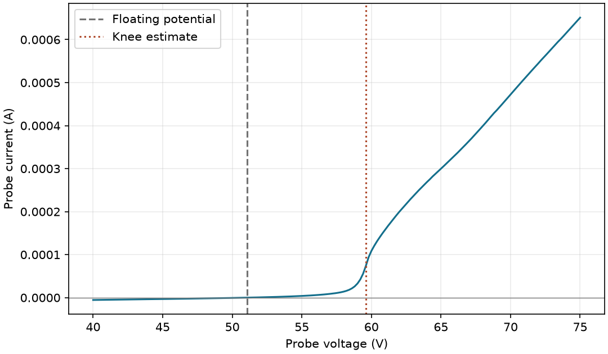
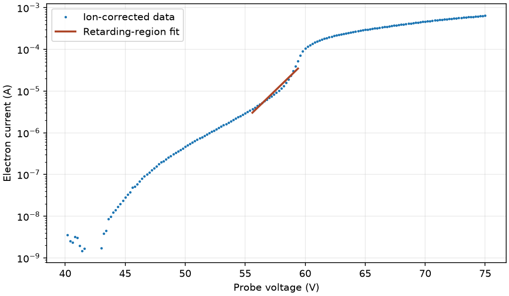

# Langmuir Probe I–V Sweep

Python software that drives an Aim-TTi SMU4201 over GPIB, plots a Langmuir probe voltage sweep live, and estimates plasma parameters from the recorded trace.

[](https://github.com/nelscamp/langmuir-probe-iv-sweep/actions/workflows/ci.yml)



## Why it exists

A Langmuir probe is an electrode placed in a plasma to collect charged particles. Sweeping its bias changes the balance of ion and electron current, producing an I–V curve. The curve can reveal where net current crosses zero, where the probe approaches the plasma potential, and how the electron current responds to bias.

```text
PC ── GPIB-USB ── Aim-TTi SMU4201
                     HI ── Probe electrode in plasma
                     LO ── Chamber ground
```

The software was built for a William & Mary capstone to acquire and analyze sweeps in low-density argon plasma generated by a heated tungsten filament at about 6.7 × 10⁻⁵ Torr.

## Quick start

Install Python 3.11 or newer, then run these commands from the repository root.

```console
python -m pip install -e .
langmuir-sweep
```

For acquisition, attach the SMU4201 through GPIB-USB and install NI-VISA and the appropriate NI GPIB driver. Choose the VISA address and click **Connect**. If the instrument was attached after launch, click **Refresh**. Set the voltage bounds, step size, and current limit, then click **Start**. The plot updates during the sweep, and **Save CSV** retains the acquisition settings, date, and instrument ID. **Pause** holds the last setpoint with output enabled. **Stop** ends acquisition and turns the output off after the current operation returns.

Use **Open CSV** and **Analyze trace** to review a saved measurement in the same app. You can also analyze the included sweep without an instrument or a desktop session.

```console
langmuir-analyze examples/voltage_current_data_23.csv --plot sweep-23.png
langmuir-analyze examples/voltage_current_data_23.csv --fit-range 55 59
python examples/plot_sweep_23.py
```

Use `--fit-range LOW HIGH` to select the retarding-region fit window in volts. The CLI prints the first and last voltages used in the fit. The example script writes the annotated I–V and semi-log plots to `docs/img/`. You can also launch the app with `python -m langmuir_probe`.

## How it works

The sweep engine sends each setpoint through a small instrument interface. The PyVISA driver uses the SMU4201 SCPI commands `SOURce:VOLTage:FIXed`, `MEASure:PRIMary:LIVEdata?`, and `MEASure:SECondary:LIVEdata?`. The engine waits 100 ms at each setpoint before reading measured voltage and current. Adaptive stepping uses the change in current between successive samples to shrink steps in steep regions and grow them in flatter regions. To add another SMU, implement the interface in `instrument.py`, adapt the SCPI commands to that model, and supply the adapter to the GUI.

The analyzer interpolates the zero crossing for floating potential, fits a linear baseline to the low-bias ion current, and estimates the plasma-potential knee from the maximum smoothed slope. It subtracts the ion baseline before fitting ln(electron current) in the retarding region. The reciprocal fitted slope gives electron temperature in eV. Its reported uncertainty is the propagated slope standard error for that trace.

## Results

The capstone recorded 23 single-probe sweeps, including one documented sweep from −100 V to +100 V. A spline-based analysis of five sweeps gave a project electron temperature of **0.8717 ± 0.0468 eV**. The plasma potential tracked the anode voltage approximately 1:1.

The tool's automated fit of sweep 23 gives **1.559 ± 0.083 eV** over **55.6–59.4 V**, with a floating potential of **51.09 V** and an estimated plasma potential of **59.6 V**. The semi-log plot shows two slopes consistent with a two-temperature, non-Maxwellian electron population, so the fitted temperature depends on the voltage window. The two results also use different fitting methods and sweep counts. [Measured sweep 23 CSV](examples/voltage_current_data_23.csv)





## Limitations

The measured curves lack clean saturation plateaus, and sheath expansion makes the ion current vary with bias. The fitted ion baseline and slope-based knee are estimates, and the temperature fit uncertainty covers regression error. Adaptive stepping was added after data collection and was **not experimentally tested**.

## What I built and what the team built

Nelson Campos wrote all of the software. Russell Burns, Nelson Campos, Sam Turner, and Georgia Stone built the probe hardware as a team for the William & Mary capstone from September 2024 to May 2025. Prof. Eugeniy E. Mikhailov advised the project.

Released under the [MIT License](LICENSE).
